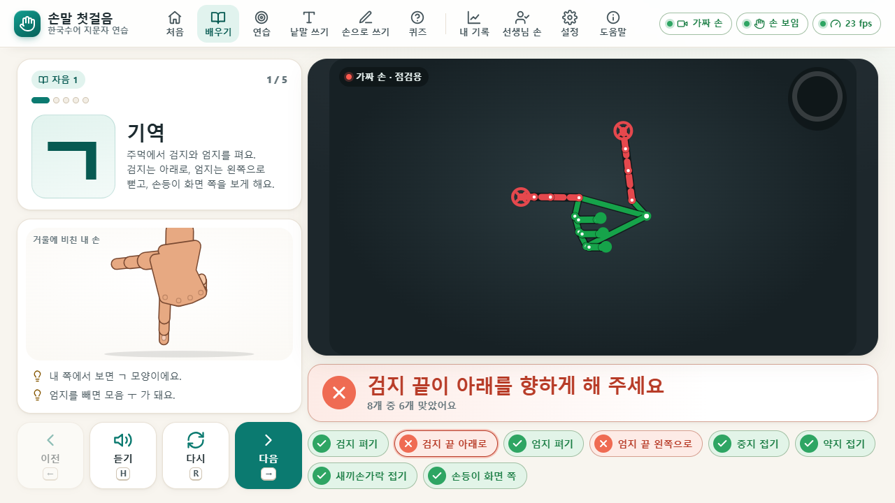
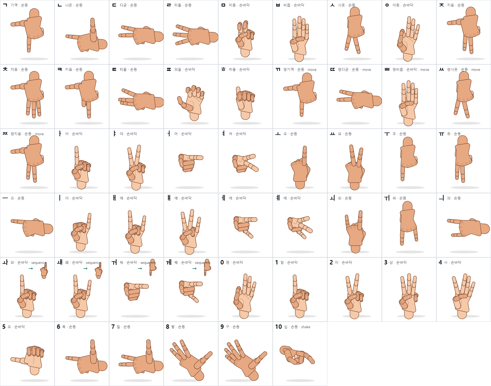

# 손말 첫걸음 (sonmal)

**웹캠 하나로 배우는 한국수어 지문자 연습 프로그램**

손말 첫걸음은 카메라로 내 손을 보고 손가락 하나하나를 짚어 주는 지문자 선생님이에요.
"약지를 접어 주세요"처럼 무엇을 고쳐야 하는지 화면과 음성으로 알려 줘요.
인터넷 없이 내 컴퓨터에서만 돌아가고, 카메라 영상은 어디에도 저장하거나 보내지 않아요.



## 누구를 위한 프로그램인가요

- 농인 자녀를 키우는 부모와 형제자매
- 농인 학생과 함께 지내는 선생님과 반 친구들
- 수어를 처음 배우는 대학생, 사회복지사, 병원·관공서 직원
- 지문자로 한글을 익히는 농아동 (소리 없이 쓰는 모드 지원)

한국수어는 2016년 「한국수화언어법」으로 인정된 농인의 언어예요. 하지만 혼자 배울 때는 내 손 모양이 맞는지 알려 줄 사람이 없어요. 손말 첫걸음이 그 빈자리를 채워요.

## 주요 기능

| 화면 | 하는 일 |
|---|---|
| 배우기 | 단원별로 한 글자씩 배워요. 기준 손 그림, 거울처럼 비친 내 손, 손가락별 맞음/틀림 표시, 가장 중요한 고칠 점 하나를 크게 보여 줘요. |
| 연습 | 복습할 글자와 약한 글자 위주로 10글자씩 연습해요 (간격 반복 복습). |
| 낱말 쓰기 | 이름이나 낱말을 넣으면 자모 순서대로 지문자를 하고, 맞힌 자모가 한글로 바로 조합돼요. |
| 손으로 쓰기 (도전) | 어떤 글자든 손으로 만들면 알아보고 글로 써 줘요. |
| 퀴즈 | 손 그림 보고 글자 맞히기, 제시된 글자를 손으로 답하기. |
| 내 기록 | 글자별 정확도, 익힌 글자, 연습한 날을 보여 줘요. |
| 선생님 손 등록 | 농인 강사나 선생님의 손 모양을 3초씩 녹화해 판정 기준으로 삼고, 파일로 다른 컴퓨터와 나눌 수 있어요. |
| 설정 | 카메라, 주로 쓰는 손(왼손잡이), 판정 엄격도, 음성, 소리 없는 모드, 글자 크기, 고대비, 어두운 화면. |

담긴 내용: **자음 14 · 쌍자음 5 · 모음 21(이중 모음 포함) · 숫자 0~10**, 모두 51개.



## 실행 방법 (Windows)

필요한 것: [Node.js](https://nodejs.org) 18 이상, 웹캠.

```bash
git clone https://github.com/nael28508-ops/sonmal.git
cd sonmal
npm install
npm start
```

또는 `npm install` 뒤 `launch.bat`을 두 번 눌러 실행해요.

- 카메라에서 50~80cm 떨어져서, 밝은 곳에서 손이 화면 가운데 오게 해 주세요.
- 키보드: ←/→ 이전/다음 글자, Space 다음, H 다시 듣기, R 다시, M 소리 끄기, C 카메라 바꾸기, Esc 뒤로.

## 개발

```bash
npm test          # 엔진 단위 테스트 (손 특징 계산, 판정 규칙, 글자 혼동 행렬, 한글 조합 등)
npm run selftest  # 숨김 창에서 가짜 손으로 모든 화면을 돌려 보고 스크린샷 저장 (카메라·소리 사용 안 함)
```

- `src/renderer/engine/`: 화면과 상관없는 순수 엔진이에요. 손 특징 추출, 판정 규칙, 손 모형, 한글 조합을 맡아요. 자세한 내용은 [engine/README.md](src/renderer/engine/README.md)에 있어요.
- `src/renderer/screens/`: 화면 10개.
- `src/renderer/core/`: 카메라, MediaPipe 손 인식, 음성, 설정, 저장.

## 솔직한 한계

- 수어 문장 번역기가 아니에요. 지문자와 숫자를 익히는 도구예요.
- 사전에서도 모양이 같은 글자(ㅏ=1, ㅑ=2, ㅇ=0, ㄴ=6)는 손 모양만으로 구분할 수 없어요. 쌍자음과 ㅘ·ㅙ·ㅝ·ㅞ는 움직임까지 봐야 구분돼요.
- 카메라 한 대로 손을 보기 때문에 조명, 각도, 손가락이 겹치는 정도에 따라 판정이 흔들릴 수 있어요. 받침 표현 같은 세부 관례는 공식 문서로 정해진 것이 없어 다루지 않아요.
- 실제 농인 강사에게 배우는 것을 대신하지는 못해요. 선생님 손 등록 기능으로 강사의 손에 맞출 수 있어요.

## 출처와 라이선스

- 지문자·지숫자의 손 모양: **국립국어원 한국수어사전** (https://sldict.korean.go.kr)의 수형 설명과 사진을 기준으로 정리했어요. 글자마다 해당 사전 항목 링크가 들어 있어요.
- 손 인식: [MediaPipe](https://developers.google.com/mediapipe) Hand Landmarker (`models/hand_landmarker.task`, Apache License 2.0).
- 프로그램 코드: [MIT License](LICENSE).
